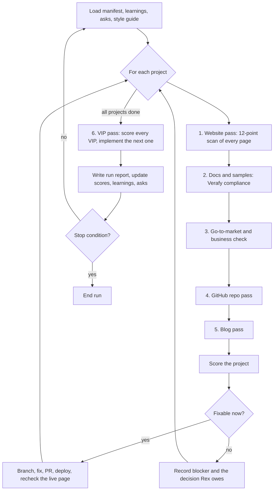

# The Verafy auto-improvement loop

A loop an agent runs, over and over, across every Verafy website, product, repository, blog post and VIP. Each run scans, scores, fixes what it can, implements the next VIP, and writes a report. This file is the plan. [manifest.json](manifest.json) is the inventory it runs over. [STYLE-GUIDE.md](STYLE-GUIDE.md) is the bar for every word. [LEARNINGS.md](LEARNINGS.md) is what earlier runs learned. [ASKS.md](ASKS.md) is every request Rex has made and its state.

Status: documented, not yet run. How to run it reliably (engine, verifiers, coverage gate, cost) is [VIP-0041](../proposals/VIP-0041-self-improvement-loop.md).

## Why the loop exists

Smart contracts settle only what code can see: balances, signatures, a price from an oracle. Everything that needs judgment (was the work done, did the event happen, was the price fair) falls back on people, courts or token votes. Verafy's bet is that a bonded, multi-provider AI jury can settle those outcomes, and that settling them is a better contract.

A bet like that is won by evidence, not by pages. Verafy now has more than a dozen products, two GitHub owners, about 25 blog posts and 40 VIPs. Each one drifts: screenshots age, copy slips, samples stop settling, repos lose their READMEs. The loop keeps every piece true, consistent and pointed at the same goal.

## Objectives

1. **Build a true successor to smart contracts.** Contracts that settle on verified, factual data, shown to be better by a list of working projects, each replacing a plain smart contract use case with a Verafy one. Measured by: the number of projects that pass the Verafy compliance check (pass 2), and the revenue they earn (pass 3).
2. **Every project clears the quality bar.** Each project scores 85 or more on the scorecard below, on every page and repo it owns.
3. **The loop keeps iterating.** Every run leaves the system measurably better or reports exactly what blocked it. Two runs in a row with no score change and no blocker reported is a loop failure.

The ultimate test is revenue: a Verafy contract is proven better when people pay for it instead of the smart contract it replaces.

## The graph

Passes run in order per project, because each feeds the next: a sample that does not settle (pass 2) changes the copy that may describe it (pass 1), and a missing repo (pass 4) blocks the blog's links (pass 5). The VIP pass runs once per loop, after every project, because a VIP can create a new project that the next loop then scans.

## Pass 1: the website

For every site in the manifest, and every page on it (from its sitemap, then by crawling links on the same host), run the 12-point scan. Each point scores 0 to 10 for that page.

| # | Point | Checks |
|---|---|---|
| 1 | Search basics | Unique `<title>` under 60 characters and meta description under 160; one `<h1>`; canonical URL; `lang` set |
| 2 | Indexing | `sitemap.xml` and `robots.txt` present and correct; no accidental `noindex`; `llms.txt` present on product sites |
| 3 | Social cards | Open Graph and Twitter tags, a 1200x630 image of the current product, correct on a link preview |
| 4 | Analytics | Google Analytics 4 tag on this page, loading after consent where required, page view firing, key events (CTA click, sign up, scan, purchase) defined. Sites the manifest excludes are skipped |
| 5 | Performance | Lighthouse performance 90 or more on mobile; LCP under 2.5 s; no layout shift from late fonts |
| 6 | Accessibility | Lighthouse accessibility 95 or more; text contrast 4.5:1; real buttons and links; alt text on every image |
| 7 | Copy against the style guide | No banned words or claims; every number labelled; no dashes; sentences and paragraphs within limits; passes the "true on a competitor's site?" test |
| 8 | Landing page structure | Context, problem, what changed, advantages, proof, one primary CTA; headline names a concrete thing; proof above the fold |
| 9 | Sales materials | Pricing or "how to buy" reachable in one click; contact path; a one-page summary a buyer can forward; customer proof labelled as such |
| 10 | Teaching | A newcomer can say what the product does after 10 seconds; a quickstart reaches a first result in 5 minutes; terms defined on first use |
| 11 | Demos | Every demo loads and completes against live data; mocks are labelled "Mock data"; devnet labelled devnet; no console errors |
| 12 | Consistency | Shared Verafy header and footer; logo, colours and fonts match the style guide; every link resolves; status labels (live, recorded, scripted, modeled) are current |

**Fixes the loop makes without asking:** meta tags, sitemaps, robots, OG images, GA tags (with the ID from the manifest), alt text, copy that breaks the style guide, broken links, stale labels, screenshots.

**Fixes it proposes and does not make:** new pricing, new claims, removing a product, anything that changes what a page promises.

## Pass 2: docs and samples, the Verafy compliance check

Read every doc page and README for the project, collect every code sample and quickstart, and run them. A sample is **Verafy compliant** only when it does all six:

| # | Check | Passes when |
|---|---|---|
| 1 | Uses the Verafy protocol | It calls the Verafy Harness or SDK, not a reimplementation of protocol logic |
| 2 | Uses a real jury | A harnessed jury (more than one model family, unless VIP-0008 single-harness mode with its challenge window) produces the ruling |
| 3 | Makes live AI calls | Jurors call real models with keys from the environment. A run with a missing key reports "not configured" and fails this check |
| 4 | Works on live data | Inputs are real (a live page, a real transaction, a real file), not fixtures, except in tests |
| 5 | Settles | The ruling is written on chain and moves or locks value according to it. Today that is the Verafy programs on Solana (VIP-0017, programs first); once Verafy Chain runs, it is Verafy Chain |
| 6 | Proves it | The sample prints the ruling account and transaction, each with a Solana Explorer link, and the result can be checked by someone who did not run it |

A project whose samples fail any check is not counted toward objective 1. The report names the failing check and the file.

The loop also checks that the docs match the code: every function, flag and endpoint a doc names exists, and every public one is documented.

## Pass 3: go-to-market and business

For each project:

| Question | Evidence the loop looks for |
|---|---|
| Which smart contract use case does this replace, and why is the Verafy version better? | A sentence on the landing page and in the README; a comparison where one fits |
| Who pays, and for what? | A price, a fee model, or a stated reason it is free (a funnel into a paid product) |
| Is it earning? | Revenue from Stripe and on-chain fees, labelled measured, against the target in the manifest |
| Is anyone using it? | Analytics from pass 1, sign ups, scans, transactions; labelled measured |
| Is the next step for a buyer obvious? | The CTA in pass 1, point 9 |
| Does it support the others? | Links to the products it depends on and that depend on it |

A project with no buyer, no price and no path to one is flagged for Rex: keep, merge into another, or archive. The loop never archives on its own.

## Pass 4: GitHub repositories

Every project in the manifest must have its own repository. For each:

| Check | Bar |
|---|---|
| Exists, on its own | One repo per project, not a folder inside another, except packages of the Verafy Harness |
| Owner | In the manifest's owner for Verafy (decision for Rex: consolidate Verafyai and VerafyTechnologies) |
| Logo | Its own logo in `docs/assets/logo.png` (and SVG), shown at the top of the README |
| README | What it is in one sentence; the context-first explanation; a current screenshot; quickstart; how it settles on Verafy; status (live, devnet, research); links to site, blog, VIPs |
| About box | Description, homepage URL and topics set on GitHub |
| Licence and security policy | Present |
| Checks | `CLAUDE.md` checks pass on main, each suite reported by name |
| Hygiene | No secrets in history; no committed build output; `.vercelignore` or equivalent keeps non-site files off the site |

A project with no repository gets one: the loop creates it, moves or scaffolds the code, adds the README and logo, and connects a Vercel project to it.

## Pass 5: blogs

Every project must have at least one blog post on blog.verafy.ai that describes its current state.

| Check | Bar |
|---|---|
| Coverage | A post exists for the project; a post exists for each shipped release worth announcing |
| Current | Screenshots captured from the live product within the last loop; claims match the current status |
| Copy | Passes the style guide, including the machine-written checks |
| Structure | Context first; one idea per section; code that runs; a link to the repo, the site and the VIP |
| Distribution | OG card, canonical URL, and a short summary suitable for X and LinkedIn |

A missing or stale post is drafted, with fresh screenshots, and opened as a PR on the blog repo. Posts are published only when Rex merges.

## Pass 6: VIPs

Score every VIP, then pick the next to implement.

**Scoring each VIP (0 to 100):**

| Part | Points |
|---|---|
| Clarity: summary, motivation, proposal, alternatives, decisions all present and specific | 15 |
| Testability: test cases that can be written as code | 15 |
| Built: code, tests and docs merged | 20 |
| Shipped: in a tagged release, on devnet | 15 |
| Verafy compliant: its sample passes pass 2 | 15 |
| Earning: revenue or usage attributed to it, measured | 10 |
| Status honest: the status line matches reality | 10 |

**Choosing the next VIP to implement:** the highest of value to objective 1, divided by effort, among VIPs whose "Decisions only Rex can make" are answered or not blocking. Ties go to the VIP that unblocks the most others (by `depends`).

**Implementing:** branch, build in `packages/` or a new repository as the VIP says, write the VIP's test cases first, deploy to devnet, update the VIP's status line, open a PR. New products get their own repository, logo, README, a Vercel project and a draft blog post, so the next loop finds them complete. DNS records are listed in the PR for Rex; the loop does not change DNS.

## The scorecard

Every page, repo and post gets a score. Scores roll up.

| Level | How it is scored |
|---|---|
| Page | Mean of the 12 website points, times 10 |
| Site | Mean of its pages, with the landing page counted three times |
| Samples | Share of samples passing all six compliance checks, times 100 |
| Repo | Share of pass 4 checks met, times 100 |
| Blog | Share of pass 5 checks met for the project's posts, times 100 |
| Business | Share of pass 3 questions answered with evidence, times 100 |
| Project | 30% site, 25% samples, 15% repo, 15% blog, 15% business |
| VIP | As in pass 6 |
| Loop | Mean project score, number of compliant projects, total measured revenue |

| Project score | Means |
|---|---|
| 85 to 100 | Ship: meets the bar |
| 60 to 84 | Fix: the loop has work to do |
| Below 60 | Rebuild or decide: flagged for Rex |

Scores are written to `docs/loop/scores/<date>/<project>.json` with every check, its evidence (URL, file, command output) and its points, so a score can be audited. A score is never estimated: an unchecked item scores zero and says why.

## Each run

1. Read the manifest, LEARNINGS, ASKS and the style guide. Re-check every repo's `CLAUDE.md`; its rules win.
2. For each project in manifest order: passes 1 to 5, score, fix, recheck the live result.
3. Pass 6.
4. Write `docs/loop/runs/<date>.md`: scores before and after, what changed (with PR links), what is blocked and the decision each blocker needs, new learnings.
5. Append to LEARNINGS and ASKS. Update the manifest with anything discovered (a new subdomain, a new repo).

**Budget per run:** set by Rex (time, model spend, number of PRs). The loop stops when the budget is spent, when every project is at 85 or more and every unblocked VIP is built, or when it is blocked everywhere.

## What the loop must never do

- Change what a page promises, a price, or a product's existence without Rex.
- Merge code to a repo whose `CLAUDE.md` says Rex merges (lineage-api). Docs-only PRs elsewhere may be merged.
- Change DNS, Stripe objects, or production environment variables. It lists them for Rex.
- Commit secrets, or put keys in samples or screenshots.
- Send any transaction to mainnet, or any email or post.
- Mint, propose or mention a Verafy token.
- Invent a number, a customer or a metric.
- Install analytics on a site whose rules forbid reader data.

## Open decisions for Rex

- The GA4 property id (one property with a data stream per site, or one per site).
- Revenue targets per project.
- One GitHub owner for Verafy, or keep both.
- Run budget and cadence (nightly, weekly).
- Whether the loop may publish blog posts or only open PRs.
